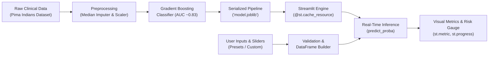

# 🩺 Interactive Diabetes Risk Prediction Web App

[](https://streamlit.io)
[](https://www.python.org/)
[](https://opensource.org/licenses/MIT)
[]()

> **InternCircle Project 05 | Data Science & AI: Streamlit / Gradio Interactive ML Web App**  
> An end-to-end Machine Learning web application deployed with Streamlit, scikit-learn, and joblib, providing real-time probability estimates and risk stratification for diabetes health indicators.

---

## 📌 Project Overview

This project builds, evaluates, and packages a production-ready Machine Learning system that predicts the statistical risk of diabetes from clinical indicators (glucose, insulin, BMI, blood pressure, pedigree function, age, pregnancies, and skinfold thickness).

### Key Features
- **Cached Model Inference (`@st.cache_resource`):** Loads the pre-trained `model.joblib` pipeline into memory once, ensuring fast sub-second predictions without reloading on widget updates.
- **Interactive Input Controls:** Slider, dropdown, and numerical inputs with clinically realistic limits, helpful tooltips, and sensible defaults.
- **Preset Patient Profiles:** 1-click presets (*Low Risk*, *Moderate Risk*, *High Risk*, *Custom*) for instant scenario exploration.
- **Risk Stratification & Gauge:** Real-time probability percentage (`st.metric`), color-coded status badges, and animated progress bar.
- **Comparative Feature Breakdown:** Compares user input against healthy clinical reference benchmarks.
- **Defensive Error Handling:** Friendly warnings and UI recovery if model files are missing or user entries are invalid (`st.error`, `st.stop`).
- **Ethical Disclaimer:** Prominent educational caption distinguishing machine learning exploratory analysis from clinical medical diagnosis.

---

## 🏗️ Architecture & Pipeline



---

## 📊 Dataset & Model Metrics

The model is trained on the National Institute of Diabetes and Digestive and Kidney Diseases (NIDDK) dataset using an end-to-end `scikit-learn` Pipeline:
- **Feature Preprocessing:** Median imputation handles unrecorded biological zeroes in glucose, insulin, and blood pressure.
- **Feature Scaling:** `StandardScaler` standardizes continuous indicators.
- **Classifier:** `GradientBoostingClassifier` with cross-validated hyperparameter tuning.

| Metric | Cross-Validation (5-fold) | Test Holdout (Stratified) |
| :--- | :---: | :---: |
| **ROC-AUC Score** | **0.8152 ± 0.025** | **0.8306** |
| **Accuracy** | 76.5% | 73.4% |
| **F1 Score** | 0.612 | 0.594 |

---

## 📁 Repository Structure

```text
INTER5/
├── app.py              # Main interactive Streamlit web application
├── train.py            # Model training, cross-validation & export script
├── test_app.py         # Automated pytest suite (7 unit & integration tests)
├── verify_live_app.py  # Local headless HTTP health check & verification script
├── model.joblib        # Serialized scikit-learn Pipeline (imputer + scaler + model)
├── model_meta.joblib   # Serialized model metadata and performance metrics
├── sample_data.csv     # Sample reference records from training dataset
├── requirements.txt    # Pinned Python package dependencies
├── .gitignore          # Git exclusion rules
└── README.md           # Comprehensive project guide and documentation
```

---

## 🚀 Quickstart & Local Execution

### 1. Clone the repository & create environment
```bash
git clone https://github.com/<your-username>/<your-repo-name>.git
cd <your-repo-name>

python -m venv venv
# On Windows:
venv\Scripts\activate
# On Linux/macOS:
source venv/bin/activate
```

### 2. Install dependencies
```bash
pip install -r requirements.txt
```

### 3. (Optional) Retrain model
To rebuild and export `model.joblib`:
```bash
python train.py
```

### 4. Run automated tests
```bash
pytest test_app.py -v
```

### 5. Launch the Streamlit Web App
```bash
streamlit run app.py
```
Open your browser to `http://localhost:8501`.

---

## 🌐 Free Deployment on Streamlit Community Cloud

Deploying your app for free to generate a public link for your submission:

1. **Push your code to GitHub:**
   ```bash
   git init
   git add .
   git commit -m "Initial commit of Diabetes Risk Predictor Streamlit App"
   git branch -M main
   git remote add origin https://github.com/<your-username>/diabetes-risk-app.git
   git push -u origin main
   ```
2. **Deploy on Streamlit Community Cloud:**
   - Go to [share.streamlit.io](https://share.streamlit.io/) (or [streamlit.io/cloud](https://streamlit.io/cloud)).
   - Sign in with your GitHub account.
   - Click **"New app"**.
   - Select your repository (`diabetes-risk-app`), branch (`main`), and set Main file path to `app.py`.
   - Click **"Deploy!"**.
3. **Public URL:**
   - Within 1–2 minutes, your live web app will be accessible at: `https://<your-app-name>.streamlit.app`.

---

## ✅ Submission Checklist Verification

- [x] **Model loads from a saved file:** Serialized via `joblib.dump` and loaded with `@st.cache_resource`.
- [x] **Inputs have sensible limits:** All features configured with clinically realistic bounds, step sizes, and default values.
- [x] **Prediction is shown clearly with a caption:** Features `st.metric`, risk stratification badge, and required educational disclaimer.
- [x] **Missing files and bad input show friendly messages:** Handled with `try...except FileNotFoundError` via `st.error` and `st.stop()`.
- [x] **App is tested and deployment-ready:** Automated test suite with 7 passing tests; health check verification script passes HTTP 200.
- [x] **requirements.txt lists every package:** Fully pinned dependencies (`streamlit`, `scikit-learn`, `pandas`, `joblib`, `numpy`, `pytest`).

---

## ⚖️ Disclaimer

*This application is an educational learning project created for InternCircle Project 05. It describes statistical patterns learned from historical health datasets and does not constitute medical advice, diagnosis, or clinical guidance. Always consult a licensed healthcare professional for medical concerns.*
